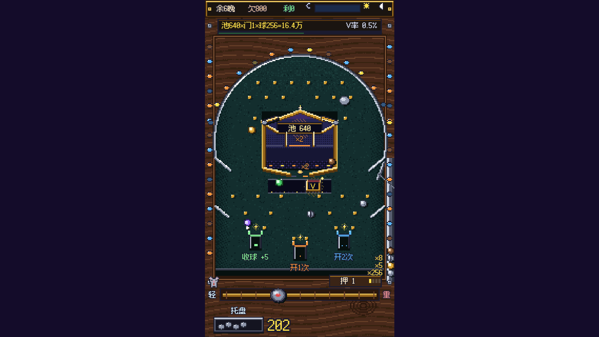

# 羽根柏青哥 Hane Pachinko

在线试玩：https://grrreymane.github.io/HanePachinko/

AIWANNA 平台页（外链到上面这个地址，2026-11-18 首发 1.0.0）：https://www.aiwanna.games/games/game-14c9bfee2c122d86 。上架资料在 `1gp-kit/`（game.json、封面、截图）。封面是游戏自己画的横版 1600×900：`shot.py . --hash "#cover" --size 1600x900 --out 1gp-kit/cover.png`（带标题，也是仓库的 cover.png 分享图），`#coverbase` 是不带字的底图（平台给其他语言叠名字用）；发布用只含已提交文件的工作目录 `D:/Minigame/_publish/HanePachinko`（`git worktree`，更新前 `git fetch` + `git -C ../_publish/HanePachinko checkout --detach origin/main`）。

你是只失业的上班族小老鼠，欠黑帮黑猫 600 球，每晚天亮收利息、一晚比一晚多一半，本金一次还清才能走人，走人前黑猫还会问你「想不想赚更多」再借一张五倍大的；交不出利息就滚进本金，他再借你更多。按住把手打一串钢珠，进口子就开羽根，接到的球在台子里过一道门乘一次，掉进 V 杯就把池子乘上倍率全倒给你。

**在线试玩：** ./

## 怎么玩

- 开局一封黑猫的借据：欠 600 球，**六晚内**攒够本金一次「还清」，到期还不上就被带走；第二晚起每晚天亮收利息，**一晚比一晚多一半**（欠 600：36、54、81、122；借了钱本金变大，利息跟着涨）。开场那屏写着今晚交多少、下一晚多少；最后一晚写「今晚到期：天亮要一次还清」。起手 50 球。顶栏左上是「余 N 晚」，算式条下面一条绿线是托盘离本金的进度。
- 还清之后剩的球**存进景品柜台**，然后二选一：「换景品走」结束这局（记录是还清了几张借据）；或「再借一张」：下一张债 ×5（3000、15000…），只到手 50 × 押注单位当本钱（第二张 100、第三张 200），池子换新，利息还是第二晚起收、每晚多一半；最低押注和借款 ×2。**只有袋子里的球带过去。** 被「带走」就什么都带不出去。
  - 为什么这样（2026-11-19 用户：「越借到后面越简单」）：以前到手一半当本钱，机器人第二张一开局就押满，收入跟借据同比涨；剩的球整笔带走，有时一进门就够还；输的球按「押注 × 球的数」进池子、进 V 再乘一次球的数，后期是平方增长；翻倍球的翻倍永久留着（第二晚就 ×216）。四处都改了之后，谨慎买球的机器人：第一张约 55% 还清，清了第一张的局里第二张约 30%，第三张更少；不买球的第一张约 40%。
- **成就**（标题页「成就」）：十条，达成一次送景品球（第一次进沼 100、一发 ×4 200、连开三轮 200、一发千球 300、池满千 300、还清一张 300、不求人 300、借到底 400、还清两张 600、十夜 200），左上角弹提示。
- **改机器**（局外，标题页「改机器」，还清后「换景品走」也会到这里）：只卖机制，不卖数值。装零件（左边 / 右边导轨 300、左下风车 400、右下磁钉 400、中间郁金香 500、大羽根 600，开局就在台上）；解锁商店的新球种（爆池球 400、开门球 400）；水沟正中装回收口 700（掉在那里的球不算掉，不裂，退回押注）；开局袋里带一颗幸运球 800。每买一样，其余的都贵五成。**买过的永远留着，但同时最多装 3 样**（用户：「一共这么多选项，但只能装备3个」）：面板上没买的写价格、点一下买（有空位就自动装上）；买了没装的写「点一下装上」；装着的那行亮绿色写「装着」，点一下卸下；满 3 样再装会提示先卸一样。只有装着的才在台上、才生效。老存档按已买的前 3 样自动装上。存在本地。 **面板是图不是字**（用户：「局外的部分……能用视觉表达的意思不要用文字」）：上面一台缩小的台子，装着的零件画在它真实的位置上，右边一个球袋画着解锁的球；中间三个装备槽；下面 10 个图标格子，没买的发暗、写价格，点一下先在小台子上闪着预览，再点才买；买了的点一下装上 / 卸下，装着的格子绿框带勾；装满时三个槽闪红，钱不够时格子闪红。
- **说明文字是大白话**（2026-11-18 用户：「看不懂……铅球……都不赔」「掉沟裂两道我也看不懂，你有点太精简了」）：每种球一句完整的好处 + 一句红字代价，不用「赔」「得分」「进台」这类行话（用「给你球」「进洞」「掉进台子」）。商店是三行横卡（球、名字、价格、两三行说明），顶上常驻两条规则：「球身上的数字越大，进洞给的球越多」「好球掉进水沟会裂，裂满 8 道变回普通球」。
- **图鉴**（标题页「图鉴」）：每种球一张卡（大球图、名字、累计打过几颗），点开看完整的好处和代价；没见过的（商店里、袋子里、庄家塞的都算见过）是剪影「？？？」。
- 天亮交完利息手里不到 20 球（或交不出）：当晚利息滚进本金，黑猫再借你 100 / 150 / 225（债和利息跟着涨）；第四次就「带走」出局。以前借钱时池子还翻倍，结果借得越多越容易一发翻身（2026-11-19 删掉）。从 2026-11-18 起每次借钱时，黑猫还会拿走袋里他最想要的那颗特殊球。
- 每晚打完先看**结算**：一行行滚出来（口子、进台、过门、漏出、V、协同、零件各经过几颗球），最后砸出「今晚 ±N」——买的东西好不好自己能验。
- 顶栏下面常驻一条算式「池 N × (门 M + 零件倍率) = X」：M 是最近一颗球过门后的倍率，零件倍率来自倍率族零件（沼 +1、成套：每件台上零件 +0.5），X 就是此刻进 V 能拿的数。连轮加倍让大奖第 2 轮起每球 ×1.5。
- **池子会漏**：每颗出台的球按倍率从池子里漏 0.3% 给你（最少 1），所以没进 V 的晚上也一直有小进账；池底 30 以下不漏。天井试过又去掉了：保底会让「什么时候来」失去悬念，现在靠漏池和六晚期限撑节奏。
- **池子**：台子里显示「池 N」。你输掉的每颗球（进水沟、进死穴）按押注进池子（不乘球的数，2026-11-19 起）；球进 **V 杯**就把 (5 + 池子) × 倍率全倒给你，池子回到 30。每局开局池子回到 30（2026-11-18 起；以前跨局保留，用户：「被黑猫带走后再开，竟然池子还继承？」，局外只留机制不留数值）。进账超过 100 时整屏金光一闪、中央蹦大数，托盘数字一秒多滚到位。
- **V 杯有多难进**（2026-11-18 用户要求约 0.5%）：杯口半宽 4.8，球（直径 6）能掉进杯里；杯口有一个**盖子**，关着是一道红条（球落上去会被弹走），开着时杯口发绿光。盖子每次开 0.35 秒，开的间隔随机，平均开 14% 的时间，进台的球约 0.5% 进 V（实测：常开 4.5%、开 13% 时 0.45%、开 25% 时 0.95%；固定节拍会和每 0.38 秒一发的发射节拍对上，所以间隔随机）。顶栏「V率」= 3.6 × 开盖比例。幸运球进台后靠近杯子时盖子会为它打开（进台后进 V 约 16%），磁暴夜金球大球也一样；冰夜盖子开得久一倍；庄家那招改成让盖子开得更少（每次 ×0.85，最少到 60%）；大奖时盖子常开。之前试过把杯口收窄到 3.96：杯壁间只剩 4.9 像素，球根本掉不进去，只能架在杯口上被弹走，用户说「感觉有点卡住」。
- **倍率门**：羽根接住的球先在台子上层落进三格之一（两边 ×1、中间 ×2，约三成进中间），再从出口的两条道掉下去（左 ×1、右 ×2；从哪边进台多半走哪边的道，中格掉下来的随机）。每过一道门灯亮一下、台子上滚数字「池 128 ×4」。大奖连轮也乘：第 1 轮 ×1、第 2 轮 ×2、第 3 轮起 ×4。
- 每晚开场一屏：托盘多少、欠多少、天亮交多少利息、下一晚的利息（池子和 V 率看顶栏算式条），打完 60 发就天亮。顶栏是「第 N 晚 · 欠 · 利」加月亮到太阳的夜晚进度（大奖中停表），左下角的托盘数够交利息时是绿的。
- 按住底部的把手就连续发球，手指左右滑动调力度（左轻右重）。**不显示飞行路线和落点**，每发的速度随机 ±8%，力度只粗略决定球往左还是往右，进不进看钉子。
- **押注**（第二晚才出现，一晚只教一个新东西；开场那屏会提一句，场上有闪烁的黄点和提示「点「押」：押几球赔几倍」，第一次切档弹出「每发押 N，赔付也 ×N / 输的球也 ×N 进池子」；第一次过门时解释顶上的算式。教过的存在本地，不重复教）：把手右上角的「押 N」点一下换档（1 / 2 / 5 / 10，键盘 ↑↓），每发扣押注那么多球，口子、进台、大奖每球的赔付按押注倍乘，输掉的球也按押注进池子；V 倒池子不乘。球不够押时自动降档。换大机器时最低押注翻倍（第二张 2/4/10/20）。一晚仍是 60 发。
- 力度和口子的关系还在（轻的多落右场、进右边蓝口；重的多落左场、进左边绿口「收球 +5」），但画面上不再标路线名和颜色，留给玩家自己摸。
- **场地（局内，第三晚起每晚一种，每种都是「一个转机 + 一个代价」）**（2026-11-18 用户：「感觉现在都是正面buff？」）：天亮时抽下一晚的场地，商店里写「明晚 xx：转机」下一行红字「代价：…」，好提前挑球、配袋；配袋屏和开局屏也写着，打球时台面左上角三行（名字、转机、红字代价）。头两晚是平常夜（一晚只教一个新东西）。十一种：
  - 磁暴夜：金球、大球进台后也被 V 杯吸 / 羽根只开一半时间。
  - 分裂夜：分裂球能分到 8 颗 / 别的球进洞只给一半。
  - 翻倍夜：翻倍球一次 ×3 / 天亮利息 ×1.5。
  - 脆钉夜：任何球撞钉 8% 撞碎，破坏球不裂 / 今晚多钉 3 根红钉（天亮拆掉）。
  - 涨潮夜：水沟正中 60 像素是回收口 / 池子不再漏球给你。
  - 冰夜：V 杯盖开得久 / 好球掉沟多裂一道。
  - 停电夜：进 V 时球的数再 ×2 / 发射管和顶栏算式里的「球」看不见（台面变暗）。
  - 收税夜：池子漏给你的 ×2 / 天亮利息 ×2。
  - 大风夜：大球也能进口子 / 发球力道 ±25%（平时 ±8%）。
  - 生锈夜：锈球碎时全袋 +2 / 好球每打出去一次就裂一道。
  - 铅雨夜：铅球进台后被 V 杯吸、杯盖为它开（铅球不给球，但进 V 照样倒池子）/ 今晚袋里多塞 2 颗铅球（天亮拿走；也算进翻倍球的倍数）。
  每晚开局台子上方弹一张横幅（场地名、转机、红字代价、它照顾的球）。每种场地有自己的样子：磁暴夜红蓝磁圈、分裂夜十字闪光、翻倍夜紫雾、脆钉夜碎屑、涨潮夜水波、冰夜下雪结霜、停电夜台面压暗、收税夜飘金币、大风夜横向风线、生锈夜锈斑和锈屑、铅雨夜灰色雨点。
- **球袋（局内，2026-11-18）**：袋子固定 12 格，开局 9 颗普通钢珠 + 3 颗随机特殊球（20 格时特殊球太稀，用户：「特殊球占比太少了，也就能买到一颗球」）。**每颗球身上有一个数**（开局都是 1），它乘这颗球赢的一切：进口子、进台、进 V 时乘池子（V 赔「池 × 门 × 球」，顶栏算式显示管子里下一颗球的数），掉沟时它也把「押注 × 数」砸进池子。每发从洗好的袋里抽一颗，剩不到 5 颗时整袋重洗垫在下面；右边发射管显示接下来 4 颗，数大于 1 的旁边标着「×N」。每晚天亮后三张球卡，第一张原价，**再拿第二张两倍价、第三张三倍价**（或者都不要），**买来的球进袋子的空位（数为 1 的普通球就是空位），袋子没空位就放上「球架」（最多 6 颗）；两边都满了才点袋里一颗换掉。**每颗特殊球都有代价（卡片第二行红字）：
  - 金球（8）：每得一次分（进口子或进台），自己的数 +1；掉沟一次裂两道。
  - 翻倍球（10）：每次进洞，袋里数最大的那颗球 ×2，**到天亮为止**（2026-11-19 前是永久的，第二晚就滚到 ×216，后面几张借据一晚清）；自己什么都不给。数一样大时挑会给球的那颗（不会翻倍翻到翻倍球、空壳这种不给球的身上）。配铅球一晚能滚到上万倍。
  - 分裂球（6）：碰钉一分二、二分四，每分一次两颗各拿一半的数。
  - 幸运球（10）：进台后被 V 杯吸过去（进台后进 V 约 8%，普通球约 0.5%）；进口子不开羽根。
  - 大球（6）：个头大，赢的 ×3；进不了口子（碰到口子被弹出来，写「太大」）。物理上和普通球一样大，只是画得大：做成 1.4 倍半径时，600 颗里有 122 颗卡在侧口子的挡柱和屋顶接缝上。
  - 破坏球（6）：撞碎碰到的钉子（红钉和死穴永久撞掉，普通钉天亮补回）；每撞一根自己裂一道。
  - 爆池球（4，要在改机器里解锁）：掉沟时池子漏 5% 给你；进口子不赔也不开羽根。
  - 开门球（6，要解锁）：进任何口子羽根开 3 次；自己不赔。
  - 铅球（2，商店也卖）：打出去什么都不给；**袋里每颗铅球让翻倍球的倍数 +1**（两颗铅球 → 翻倍球 ×4）。庄家换进来的铅球带黑猫记号，挪不出袋子，只能用商店的「洗铅」洗回普通球。
  - 锈球（3）：每晚开打前自己裂两道；**碎的那一下袋里每颗球的数 +1**（生锈夜 +2）。
  - 空壳球（4）：自己进洞什么都不给；**紧跟它的下一颗球数 ×2**（两颗空壳连着 ×4），发射管里标得出来。
  - 黑猫球（5）：进口子、进台不给球，反而从托盘叼走同样多；**进 V 时池子再 ×3**。
  负面球单看是坏的，配对了是奇效（用户：「负面的球也可以多一点，但在某种情况，它会给玩家带来奇效」）：铅球 + 翻倍球、锈球 + 大数的球、空壳 + 金球、黑猫 + 幸运球 / 铅雨夜。开局 3 颗随机特殊球只从正面球里抽。
  **配袋（每晚开打前，像组卡组）**（用户：「是不是玩家在一晚上开局前能调整自己珠子的占比？比如像卡牌游戏」）：商店的按钮写「装袋」，进配袋屏：上面袋子 12 格（空位是淡淡的普通球），下面球架 6 格；每格球下面写短名（金球、翻倍、铅球…），数大于 1 的右上角标「×N」。**点一颗只是选中**（红框），下面说明栏写它的全名、裂了几道、好处和红字代价，再按说明栏里的「去球架」/「放进袋子」才挪（2026-11-19 用户：「装袋的时候完全不知道自己有什么球」；以前只有颜色，点一下就挪）。黑猫塞的铅球说明栏写「拿不出来，商店里能洗掉」，没有按钮。按「开打」直接开始这晚。抽哪颗还是随机的，只能决定袋里装什么。没有可挪的球时商店直接「开打」。黑猫抵债会从袋子和球架里挑。
  **好球会碎**：特殊球掉进水沟或死穴裂一道（球上看得见），得分修好一道，裂满 8 道碎成数为 1 的普通球（裂纹分三档画，最后一档带红）。**交不起利息时，黑猫除了借钱，还拿走袋里他最想要的那颗**（数最大的优先）。**价格跟着下一晚的利息走**：括号里的数是「16 = 一晚利息」的份数（第二晚前利息 36 → 价格 × 2.25，第五晚前 122 → × 7.6；借钱、换下一张借据都会让利息和价格一起涨），每买一颗后面的再贵 10%，同一晚第二张 ×2、第三张 ×3；重摇、洗铅也按利息算。2026-11-19 前价格跟着债走、几乎不涨，后期什么都买得起。
  历史：灌球按钮 → 连口 → 金圈慢动作 → 屋顶门慢动作，都在考手，全删了；第一版球袋只有好处（用户：选择没代价、只会越来越强），于是加了坏处、三选一、固定格、碎球、黑猫抵债；用户又要「局内数值互相影响、指数增长，局外要机制」，试过整局的「倍」（翻倍球进台 ×1.5），后来改成每颗球带数、球之间传数；用户提议的大球、破坏球也加了。
- 球进底下三个口子之一：中间的橙口 +2 并让羽根张开一次，右边的蓝口 +2 张开两次，左边的绿口 +5 不开羽根（开门球除外）。羽根一开就开 0.5 秒，掉在上面的球滚进台子（+1）。进 V 后羽根连开 12 次，接到的每球 +4 × 轮次倍率，接满 6 个算一轮，一轮里再进 V 续下一轮（最多 5 轮）。以上都按押注倍乘，金球再 ×3。
- 托盘够交利息时随时能「收摊」保本，够本金时按钮变成「还清」。
- 第二晚起庄家轮流加料（四样轮换）：红钉、把你袋里随机一颗球换成铅球（可能是你的好球）、死穴（吞球）、V 杯改窄；然后是三选一的球卡商店（见「球袋」）。
- 卡球保险：球 1.2 秒没挪动 4 像素就踢一下，第四次移除；天亮后还有球在台上乱撞超过 8 秒直接清掉。导轨很短（半长 9，Lv2 是 12）且不伸进墙，球从旁边掉下去而不是卡住。
- 美术：固定调色板，木纹柜体、铬轨、黄铜役物带瓦片屋顶和显示屏、钉子和钢珠三档明暗加落影、霓虹口子、灯带追逐。静态部分（木、绒布、轨、牌匾、把手槽、托盘）开局画一次存离屏画布，每帧只画会动的。借据和借款面板上是黑猫，把手左下蹲着小老鼠，进账时会跳。
- 试玩机器人：`_human.js` 的 `__human(局数, {careful:true})` 按小丑牌 / 幸运房东玩家的口味打：按手头钱换押注，看卡片挑球（留够当晚利息加 15 才买；`{greedy:true}` 只留利息），袋里有铅球就洗，袋子满了换掉最不值钱的那颗，连闷三晚会「想关游戏」；`{noshop:true}` 是从不买球的对照组。日记每晚一行，含袋里好球数、碎了几颗、袋里最大的数。2026-11-18 实测（各 20 局，只打第一、二张借据）：greedy 赢 13（4 局还清第二张），袋里最大的球最高 ×1024、平均 ×16；不买的赢 7。最好的一局最大的球 ×2 → ×32 → ×128 → ×1024，那晚托盘 338 → 19011，第二张借据第一晚一次进账 40 万，然后那颗球碎了。一晚约 30 秒。 V 率降到 0.5% 并加了场地后（各 20 局）：greedy 赢 8（2 局还清第二张），最大球最高 ×1024、平均 ×23；不买的赢 3。 袋子改 12 格、开局 3 颗特殊球、能多买、8 道裂纹后（各 20 局，127.0.0.1 上跑，不碰玩家存档）：greedy 赢 17（11 局还清第二张），袋里平均 3.2 颗特殊球；不买的赢 12。数字会滚到几百亿，`fmt` 认万 / 亿 / 兆。
- 物理用本地 `lib/matter.min.js`（Matter.js 0.20）。原型阶段：`_test.html#window.__g=function(s){return eval(s)}` 里有 `window.__sim(力度, 次数)`；`_trace.js` 的 `__trace(力度, 次数, {keepFiring:true})` 打出不含池子的基础经济和各类事件数（gC / gG 是过中格、过右道的次数）。机器人按固定力度连发、不买零件，16 局全在 1～5 晚内还清，借 0～2 次，单次最大进账 200～1800。`_art_sample.html` 是最早的美术样板（已做进游戏，可删）。

## 本地运行

整个游戏是一个 `index.html` 加一个 `lib/` 文件夹，没有构建步骤，直接用浏览器打开即可（或 `python -m http.server` 后访问）。进度保存在浏览器本地存储里。

改了游戏里的文字后运行 `python D:/Minigame/_workflow/tools/subset_font.py .` 更新字体子集。
